# Manual do sistema SIFIT

**SIFIT — Sistema para Academias**  
Extensão em Qualidade de Software · 2º bimestre · trabalho em grupo (até 4 pontos)

| | |
| --- | --- |
| Dupla | Diego e Wallace |
| Professor | Adnys Lougan |
| Ambiente | https://sifit.centrion.com.br |
| Perfil usado | Administrador (usuário da aula, nome exibido: Jair) |
| Data | 19 de novembro de 2026 |
| API | https://backendsifit.centrion.com.br/api/ |
| Unidade na URL | o sufixo `/1` nas rotas é o código da academia logada |

Nenhum cadastro foi salvo, alterado ou excluído. Os formulários foram abertos só para documentar campos. As senhas do slide não entram neste manual.

## 1. O que este manual cobre

O SIFIT é o sistema web da academia. O menu lateral organiza a operação em nove blocos:

1. Principal — página inicial, dashboard e presenças
2. Operação da academia — clientes, matrículas, avaliações e contas
3. Treinamento — ficha, exercícios, grupos musculares, objetivos, grupos e turmas
4. Financeiro — caixas, Pagar.me, despesas fixas e relatórios
5. Comercial — prospecção, planos, contratos, tipos de pagamento e bandeiras
6. Gestão — colaboradores, funções, fornecedores, documentos, atividades, pontuação, produtos e enquetes
7. Saúde — anamnese (fichas, modelos, categorias e perguntas)
8. Inteligência — automações e resultados
9. Configurações — parâmetros da academia, modelo de ficha e aplicativo

Cada funcionalidade abaixo traz objetivo, caminho, passo a passo, campos, print e a chamada que a tela faz até a persistência.

## 2. Como a tela chega ao banco

O fluxo observado em todas as telas autenticadas é o mesmo:

1. O navegador abre a rota do SIFIT (aplicação Vue em `sifit.centrion.com.br`).
2. A tela confirma a sessão com `POST /api/verifica-token-logado`.
3. A tela pede os dados da função em `https://backendsifit.centrion.com.br/api/.../1`.
4. A API responde JSON. Esse JSON é o contrato do que o backend grava e lê.
5. O MySQL informado na aula foi aberto em seguida, só para leitura.

Resultado do passo 5, medido em 19/11/2026:

| Verificação | Resultado |
| --- | --- |
| Schema | `u339572246_alfa1` |
| Tabelas | 43 |
| Tabelas com nome de matrícula, presença, treino, caixa ou avaliação | nenhuma |
| `clientes` nesse MySQL | 1 registro, maior `id` 433 |
| `produtos` | 1 registro |
| `pedidos` | 0 |
| Conteúdo real do schema | loja virtual (marcas, banners, artigos, grupos como "Placas de Vídeo", categorias como "Notebook Gamer") |

A listagem de alunos do SIFIT, na mesma data, mostra centenas de códigos (a tela de Clientes indica 151 cadastrados, com códigos na casa de 440). Esses registros não estão no MySQL do slide. A evidência de persistência do SIFIT, portanto, é a API autenticada documentada em cada função. Cada tabela do MySQL da aula tem o próprio print em `evidencias/banco/tabelas`.

Prints visuais da consulta somente leitura, no mesmo formato das telas do sistema, gravados em `evidencias/banco/`:

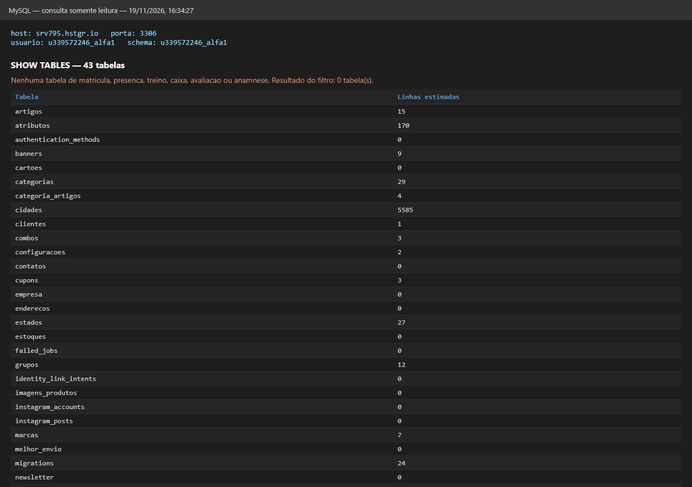

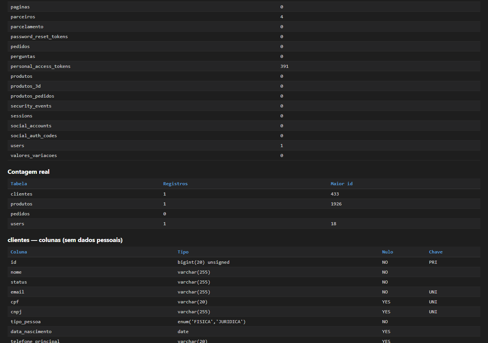

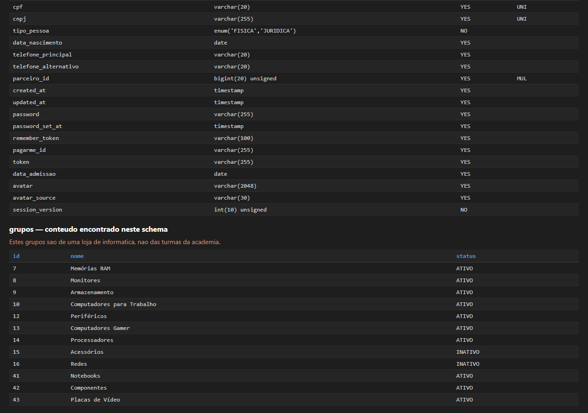

As categorias e as marcas desse schema estão em `evidencias/banco/05-resultado-completo.png`. Cada uma das 43 tabelas do MySQL tem o próprio print em [evidencias/banco/tabelas](evidencias/banco/tabelas).

Chamadas comuns a quase toda tela, além da função em si:

- `POST /api/verifica-token-logado`
- `POST /api/usuario/tema/buscar`
- `GET /api/onboarding`
- `GET /api/posts/tela-web/1`
- `GET /api/denuncias/tela-web/1`

Os vídeos abrem nesta página, com um player para cada parte: [assistir os vídeos](https://ale7639.github.io/extensao-6-SIFIT-Diego-Wallace/manual-sifit/evidencias/video/assistir.html). O percurso completo continua em `evidencias/video/manual-sifit-telas.mp4`.

## 3. Acesso

### 3.1 Login

Objetivo: autenticar o usuário e abrir a academia.

Caminho: https://sifit.centrion.com.br/login

Passo a passo:

1. Abrir a URL de login.
2. Informar o login no campo **Login**.
3. Informar a senha no campo **Senha**.
4. Opcional: marcar **Manter conectado**.
5. Clicar em **Entrar**.
6. O sistema redireciona para `/dashboard` e exibe a saudação com o nome do usuário.

Há também o link **Esqueci minha senha**.

Evidência:

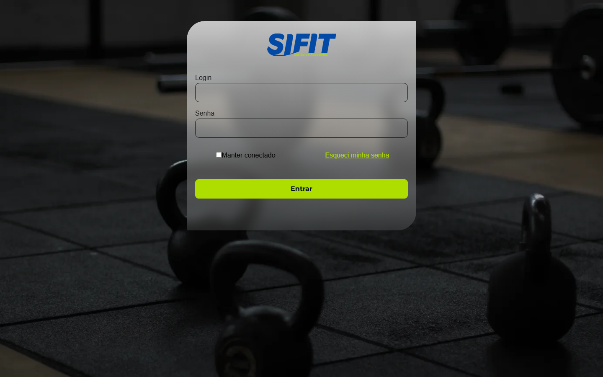

Persistência: a sessão passa a ser validada por `POST /api/verifica-token-logado` nas telas seguintes. O tema do usuário é lido em `POST /api/usuario/tema/buscar`.

### 3.2 Tema e sessão

No topo de cada tela interna existem **Claro**, **Escuro**, o sino de notificações e o menu do usuário (nome, perfil Administrador e **Sair**). O tema escolhido é gravado pela API de tema do usuário.

## 4. Principal

### 4.1 Página inicial

Objetivo: resumir o dia da academia e sugerir ações.

Caminho: menu **Principal → Página Inicial** (`/dashboard`).

Passo a passo:

1. Entrar no sistema.
2. A página abre já selecionada.
3. Ajustar o período nos dois campos de data e clicar em **Buscar**, se quiser outro intervalo. No levantamento o período exibido era 01/11/2026 a 30/11/2026.
4. Ler os cartões: alunos em risco, valor em aberto, pico de movimento, clientes ativos, ausentes, sem matrícula, matrículas no período, desistências e renovações.
5. Na faixa **Inteligência de Retenção**, ver alto, médio e baixo risco e o motivo principal (no dia, ausência prolongada).
6. Usar as ações do dia: cobrar alunos em aberto, falar com inativos ou ver avaliações.
7. Mais abaixo estão frequência por horário e por dia da semana, mensalidades pendentes, agenda, últimas entradas e aniversariantes.

Evidência:

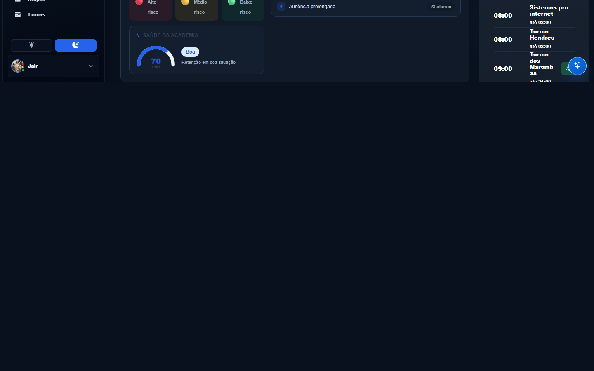

Persistência (exemplos capturados nesta tela):

| Método | Caminho | Uso |
| --- | --- | --- |
| GET | `/api/dashboard/retencao/1` | risco e saúde da retenção |
| POST | `/api/dados-principais-home/1` | indicadores do período |
| POST | `/api/presencas/1` | entradas |
| POST | `/api/horarios-entrada-alunos/1` | pico por horário |
| POST | `/api/porcentagem-frequencias/1` | frequência |
| POST | `/api/clientes/maiores-presencas/1` | quem mais treinou |
| POST | `/api/listar-ultimas-avaliacoes/1` | avaliações recentes |
| GET | `/api/turma/listar/1` | agenda |

Os números da tela (por exemplo 33 ativos, 33 ausentes, 27 sem matrícula, R$ 122,00 em aberto) são a resposta dessas chamadas, não linhas do MySQL `u339572246_alfa1`.

### 4.2 Dashboard analítico

Objetivo: gráficos de gestão, separados da página inicial operacional.

Caminho: menu **Principal → Dashboard** (`/dash`).

Passo a passo:

1. Abrir **Dashboard**.
2. A tela mostra despesas fixas e o bloco **Inteligência Sifit**, com atalho **Ver Inteligência**.
3. Os gráficos consultam presença por dia, faixa etária, sexo, matrículas canceladas por mês e avaliações por mês.

Evidência:

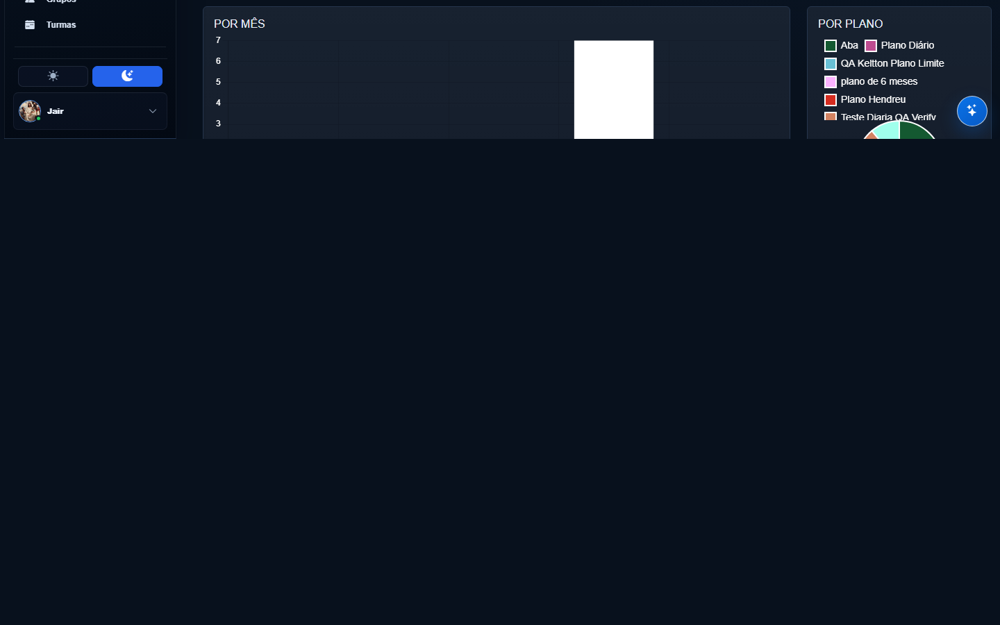

Persistência:

| Método | Caminho |
| --- | --- |
| POST | `/api/presenca-por-dia/1` |
| POST | `/api/pessoas-faixa-etaria/1` |
| POST | `/api/percentual-sexo/1` |
| POST | `/api/matriculas-canceladas-por-mes/1` |
| POST | `/api/avaliacoes-por-mes/1` |
| GET | `/api/inteligencia/resultados/1` |

### 4.3 Presenças

Objetivo: consultar quem entrou na academia em um intervalo.

Caminho: menu **Principal → Presenças** (`/presencas`).

Passo a passo:

1. Abrir **Presenças**.
2. Preencher **DE** e **ATÉ**.
3. A lista é paginada pela API de presenças.

Evidência:

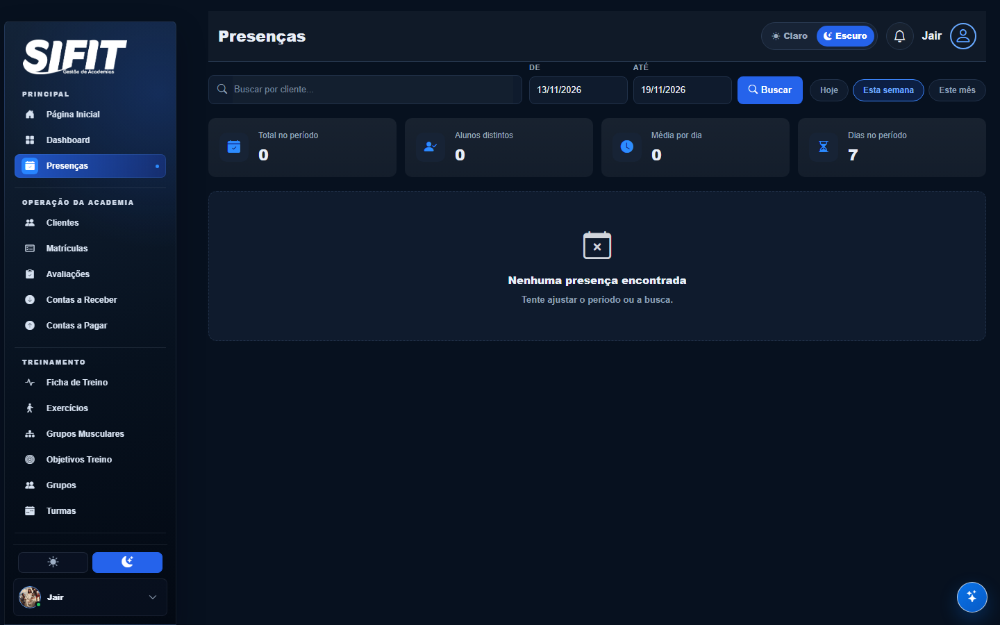

Persistência: `POST /api/presencas/paginacao/1`.

O registro de presença em si nasce da catraca, da biometria ou do controle configurado em **Configurações** (campo **Controle de Presença**). Esta tela é a consulta.

## 5. Operação da academia

### 5.1 Clientes

Objetivo: cadastrar e localizar alunos.

Caminho: menu **Operação da academia → Clientes** (`/clientes`).

Passo a passo da consulta:

1. Abrir **Clientes**.
2. Filtrar por código, nome, status, situação, plano e personal.
3. Clicar em **Buscar**.
4. A tabela mostra código, nome, plano, status e biometria / última visita.
5. Os cartões acima da tabela resumem cadastrados, ativos, sem matrícula e ausentes. No levantamento: 151 cadastrados, 33 ativos, 27 sem matrícula e 0 ausentes no filtro que estava na tela.
6. Usar **Anterior** / **Próxima** para paginar.

Passo a passo do cadastro (formulário aberto, não enviado):

1. Clicar em **Novo Cliente** ou abrir `/adicionar-cliente`.
2. Preencher identificação: nome, status, sexo, data de nascimento e tipo sanguíneo. O código é gerado pelo sistema.
3. Documentos: CPF e RG.
4. Foto (JPG, PNG ou GIF).
5. Contato: telefone, celular / WhatsApp, contato de emergência e e-mail.
6. Endereço, começando pelo CEP. País, estado e cidade vêm da API.
7. Clicar em **Cadastrar Cliente** para gravar, ou **Cancelar** para voltar. Nesta evidência usamos **Cancelar**.

Evidências:

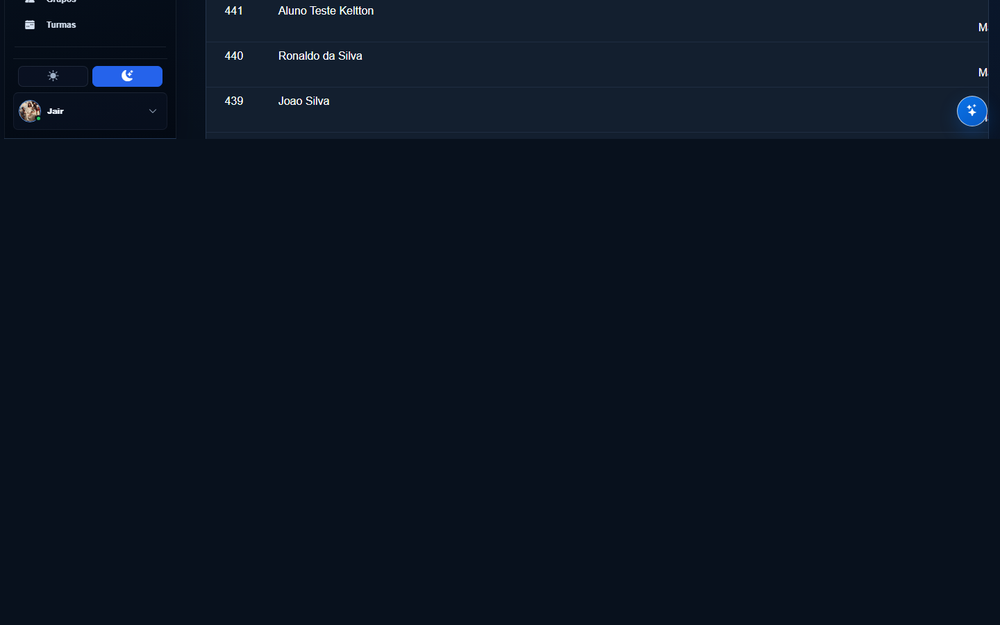

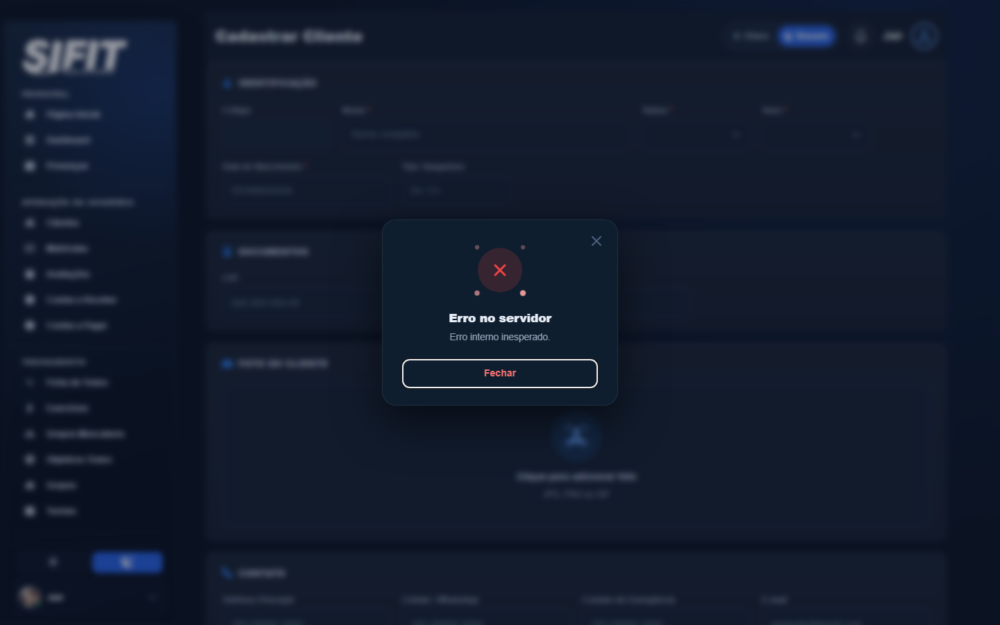

Persistência:

| Ação | Método | Caminho |
| --- | --- | --- |
| Lista e totais | GET | `/api/clientes/tela-web/1` |
| Página da tabela | POST | `/api/clientes-paginacao/1` |
| Total | GET | `/api/total-clientes/1` |
| Planos do filtro | GET | `/api/planos/1` |
| Personais do filtro | GET | `/api/colaboradores-personais/1` |
| País, estado e cidade do formulário | POST | `/api/paises`, `/api/estados`, `/api/cidades/16` |
| Gravação (não executada) | POST | `/api/cadastrar-cliente/1` |

O código exibido na grade é a chave do aluno na API. Esse código não foi encontrado como cadastro de academia no MySQL do slide: lá `clientes` tem um único registro de loja e não há colunas de plano, biometria ou matrícula.

### 5.2 Matrículas

Objetivo: vincular o aluno a um plano, com vigência, valor e vencimento.

Caminho: menu **Operação da academia → Matrículas** (`/matriculas`).

Passo a passo da consulta:

1. Abrir **Matrículas**.
2. Filtrar por código e nome.
3. Clicar em **Buscar**.
4. A tabela mostra código, nome, plano e status.
5. Os indicadores da tela vêm de matrículas do mês, recorrentes, ativas e não renovadas.

Passo a passo do cadastro (formulário aberto, não enviado), em `/adicionar-matricula`:

1. Clicar em **Cadastrar Matrícula**.
2. Conferir quem cadastrou, a data e o status.
3. Localizar o aluno (código e nome).
4. Escolher modalidade / plano, data inicial, data final, pagamento pelo sistema, tipo de pagamento, taxa de matrícula, dia de vencimento e valor da parcela.
5. A configuração da academia decide se, ao concluir, o sistema pergunta sobre anamnese.
6. Salvar somente quando o dado for real. Nesta evidência o formulário não foi enviado.

Na lista também existe **Cancelar Matrícula**, com campo **Motivo de Cancelamento**. Não foi usado.

Evidências:

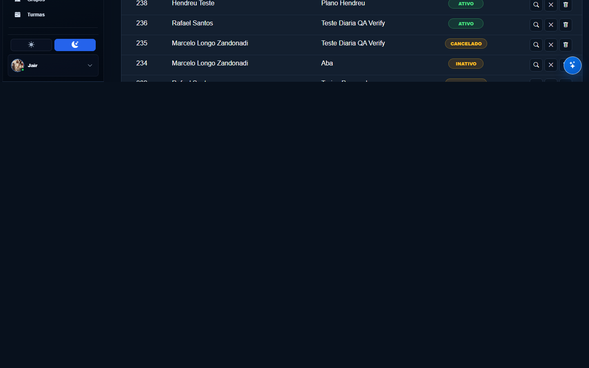

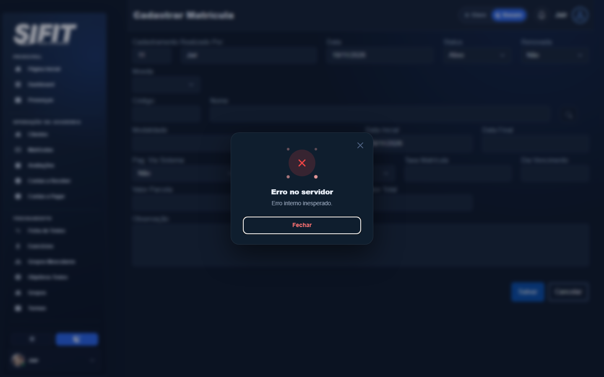

Persistência:

| Método | Caminho |
| --- | --- |
| POST | `/api/matriculas/paginacao/1` |
| POST | `/api/qtd-matricula-mes-atual/1` |
| POST | `/api/qtd-matriculas-ativas/1` |
| POST | `/api/qtd-matriculas-nao-renovadas/1` |
| GET | `/api/matriculas/qtd-recorrente/1` |
| GET | `/api/planos/1` |
| GET | `/api/tipo-pagamento/1` |
| GET | `/api/configuracoes/1` |
| POST | `/api/salvar/matricula/` (gravação, não executada) |
| — | `/api/cancelar-matricula/` (cancelamento, não executado) |

### 5.3 Avaliações físicas

Objetivo: registrar e comparar medidas do aluno.

Caminho: menu **Operação da academia → Avaliações** (`/avaliacoes`).

Passo a passo:

1. Abrir **Avaliações**.
2. Filtrar por código, nome e status e clicar em **Buscar**.
3. A tabela mostra código, nome, data / hora, personal, status e ações.
4. As ações abrem a ficha da avaliação, a comparação entre avaliações e a alteração de data / hora.
5. No cadastro (`/adicionar-avaliacao`), informar o aluno, o personal, a data, a hora e o tipo de pesquisa.
6. A ficha de medidas, visível no modal da lista, inclui idade, altura, peso, IMC, pescoço, ombros, tórax, braços, antebraços e abdômen, além das abas **IMC**, **Circunferência**, **Teste Físico** e **Composição Corporal**.

Evidências:

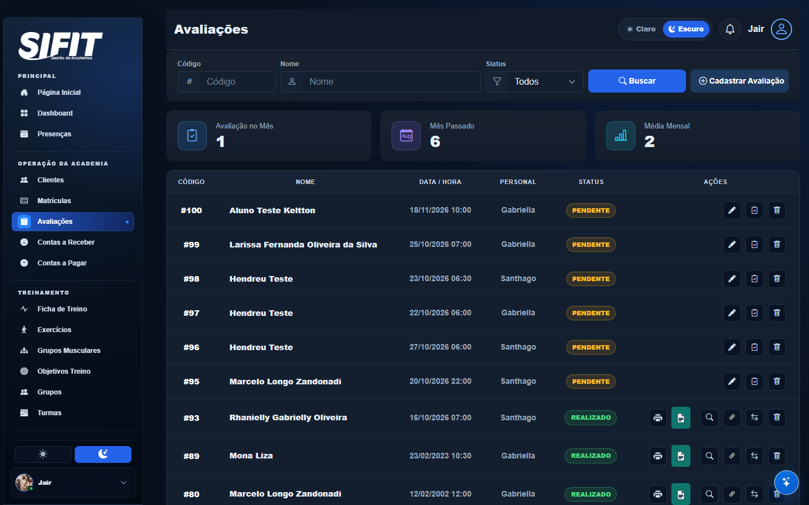

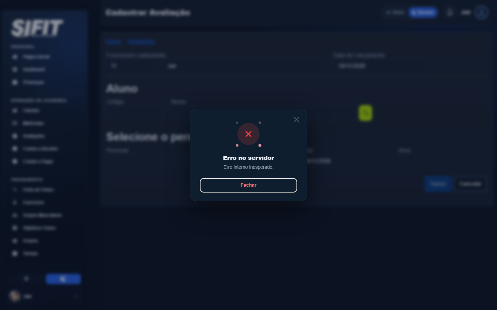

Persistência:

| Método | Caminho |
| --- | --- |
| GET | `/api/avaliacao/tela-web/1` |
| POST | `/api/listar-ultimas-avaliacoes/1` |
| POST | `/api/qtd-avaliacoes/1` |
| POST | `/api/colaboradores-avaliadores/1` |
| POST | `/api/avaliacao/salvarFeita/` (gravação, não executada) |

### 5.4 Contas a receber

Objetivo: lançar e acompanhar o que o aluno deve à academia.

Caminho: menu **Operação da academia → Contas a Receber** (`/contas-receber`).

Passo a passo:

1. Abrir **Contas a Receber**.
2. Filtrar por código, nome, tipo de data, data inicial, data final e status.
3. A tabela mostra código, cliente, título, valor a receber, valor recebido e status.
4. Em **Nova Conta** (`/adicionar-conta-receber`), informar cliente, título, se cria cópias, valor, moeda, vencimento, observação e o caixa aberto.
5. Receber uma conta é outra ação da lista (`/api/conta-receber/receber/`). Não foi executada.

Evidências:

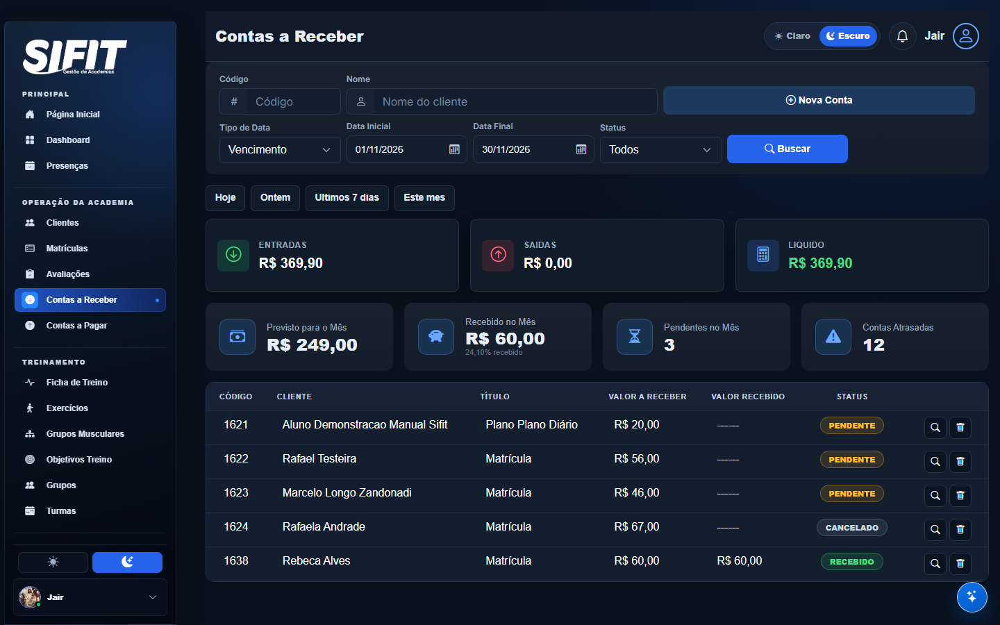

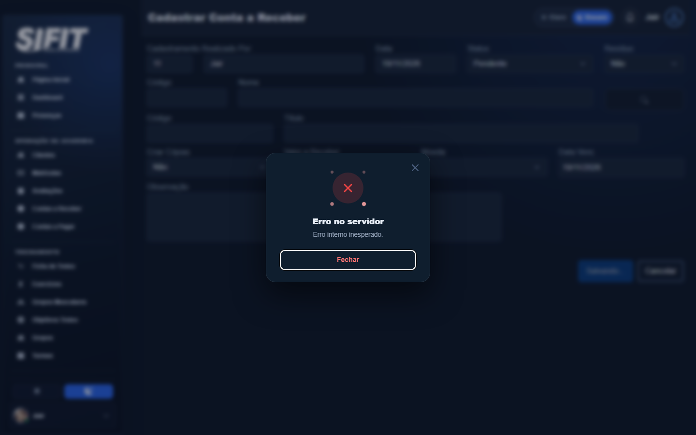

Persistência:

| Método | Caminho |
| --- | --- |
| POST | `/api/contas-receber/tela-web/1` |
| POST | `/api/contas-receber/por-data/1` |
| POST | `/api/contas-receber/vencidas/1` |
| GET | `/api/local-contas/1` |
| GET | `/api/tipo-pagamento/1` |
| GET | `/api/empresa/moedas/1` |
| POST | `/api/seleciona/caixa-aberto/1` |
| POST | `/api/cadastrar-conta-receber/` (gravação, não executada) |

No dia do levantamento a página inicial mostrava R$ 122,00 em aberto, lido dessa mesma base de contas.

### 5.5 Contas a pagar

Objetivo: controlar despesas com fornecedor ou colaborador.

Caminho: menu **Operação da academia → Contas a Pagar** (`/contas-pagar`).

Passo a passo:

1. Abrir **Contas a Pagar**.
2. Filtrar por código, nome, tipo de data, período e status.
3. A tabela mostra código, fornecedor / colaborador, título, valor a pagar, valor pago e status.
4. Em **Nova Conta**, informar tipo, tipo de despesa, status, título, fornecedor ou colaborador, documento, data de emissão, categoria, valor e vencimento.

Evidências:

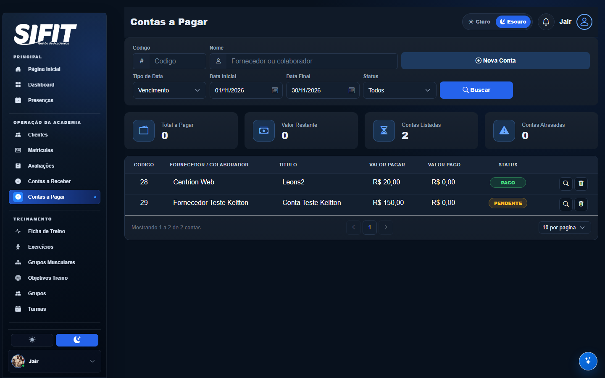

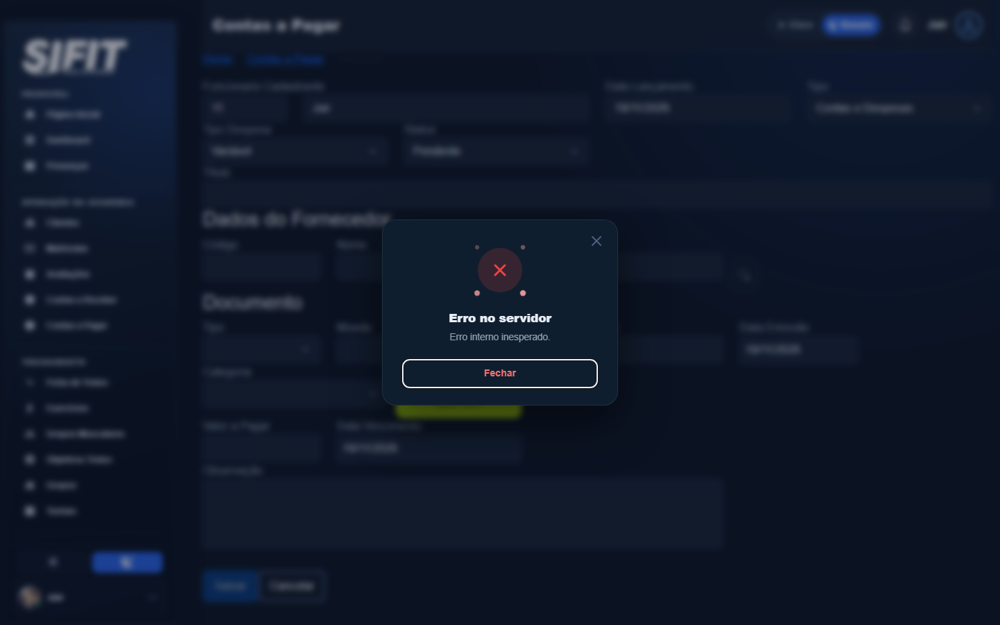

Persistência:

| Método | Caminho |
| --- | --- |
| POST | `/api/contas-pagar/por-data/1` |
| GET | `/api/contas-pagar/qtd-vencidas/1` |
| GET | `/api/tipos-documento/1` |
| GET | `/api/despesas-fixas/1` |
| POST | `/api/categoria-contas-pagar/1` |
| POST | `/api/cadastrar-conta-pagar/` (gravação, não executada) |

### 5.6 Ficha de treino

Objetivo: montar o treino do aluno, com período, objetivo e exercícios.

Caminho: menu **Treinamento → Ficha de Treino** (`/fichas-treino`).

Passo a passo:

1. Abrir **Ficha de Treino**.
2. Filtrar por código, nome do aluno e status.
3. A tabela mostra código, aluno, data inicial, data final, status e ações.
4. **Cadastrar Ficha** abre o formulário com personal, datas, objetivo e observação. A rota direta `/adicionar-ficha-treino` voltou para a lista; o cadastro usado na interface é o botão da própria lista.
5. A montagem dos exercícios usa a biblioteca de **Exercícios** e pode partir de um **Modelo de Ficha**.

Evidência:

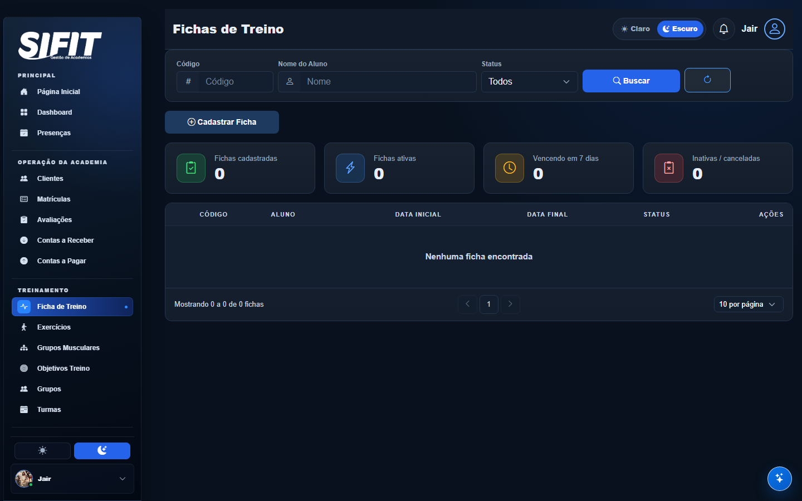

Persistência:

| Método | Caminho |
| --- | --- |
| GET | `/api/fichas/1` |
| GET | `/api/objetivos-treino/1` |
| POST | `/api/colaboradores-avaliadores/1` |
| POST | `/api/salvar-treinos-ficha/` (gravação da montagem, não executada) |
| POST | `/api/adicionar-ficha/` (gravação, não executada) |

## 6. Treinamento

### 6.1 Exercícios

Objetivo: manter a biblioteca de exercícios usada nas fichas.

Caminho: menu **Treinamento → Exercícios** (`/exercicios`).

Passo a passo:

1. Abrir **Exercícios**.
2. A tela agrupa os exercícios por grupo muscular. No levantamento apareceram grupos já cadastrados na academia (bíceps, pernas, peitoral e grupos de teste).
3. **Adicionar** abre o formulário com código, nome, tipo de membro e imagem.
4. **Salvar** grava; **Cancelar** fecha. Nada foi salvo.

Evidência:

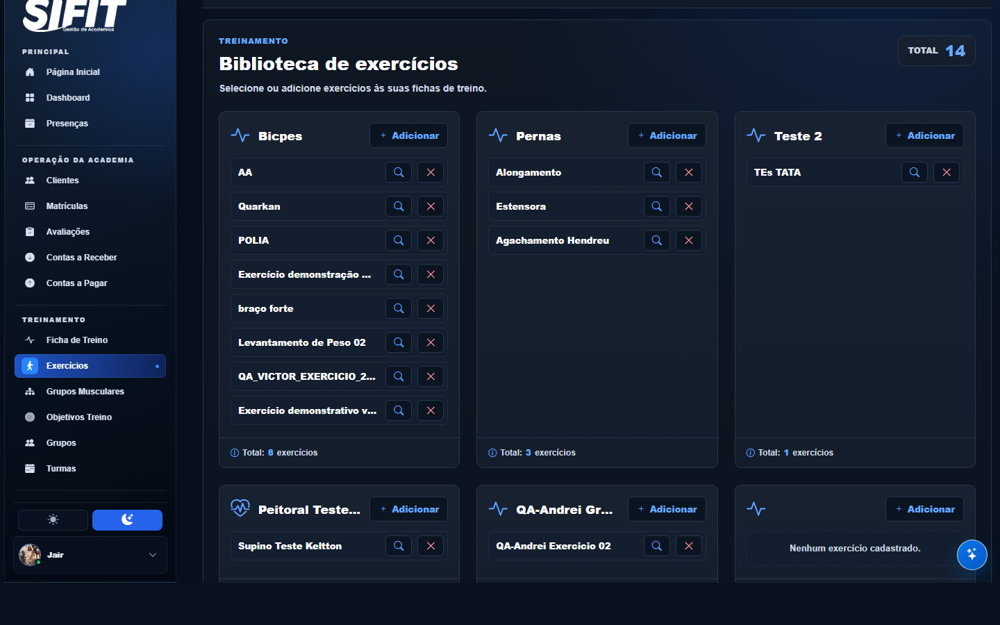

Persistência: `POST /api/grupo-muscular/1` carrega os grupos. A inclusão usa `POST /api/cria/exercicios/` e a importação da biblioteca usa `POST /api/importa/biblioteca-exercicios/`. Nenhuma das duas gravações foi executada.

### 6.2 Grupos musculares

Objetivo: classificar exercícios por região do corpo.

Caminho: menu **Treinamento → Grupos Musculares** (`/grupos-musculares`).

Passo a passo:

1. Abrir a lista.
2. Filtrar por código e nome.
3. A tabela mostra código, nome, tipo de membro, imagem e ações.
4. O formulário pede código, nome, tipo de membro e imagem.

Evidência:

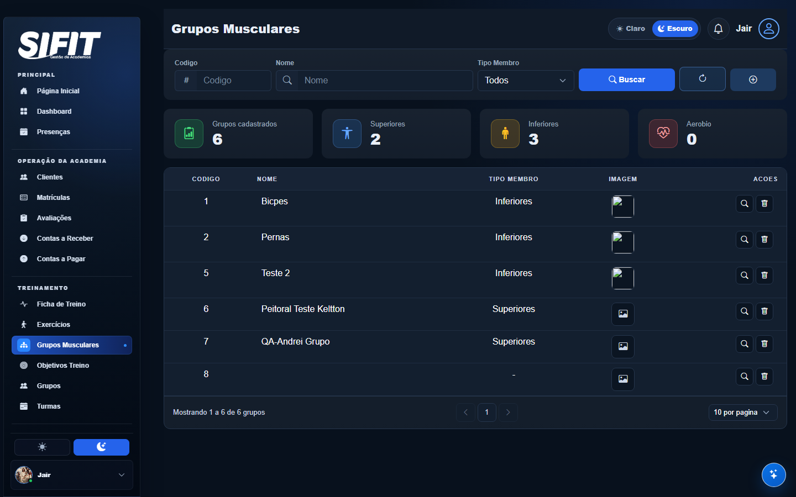

Persistência: `POST /api/grupo-muscular/1`. Criar e editar, não executados, usam `/api/web/cria/grupo-muscular/` e `/api/web/edita/grupo-muscular/`.

### 6.3 Objetivos de treino

Objetivo: cadastrar objetivos que a ficha pode usar (emagrecimento, hipertrofia etc.).

Caminho: menu **Treinamento → Objetivos Treino** (`/objetivos-treino`).

Passo a passo:

1. Abrir a lista e buscar por código ou nome.
2. Clicar em **Novo Objetivo**.
3. Informar nome e descrição.
4. **Salvar** ou **Cancelar**.

Evidência:

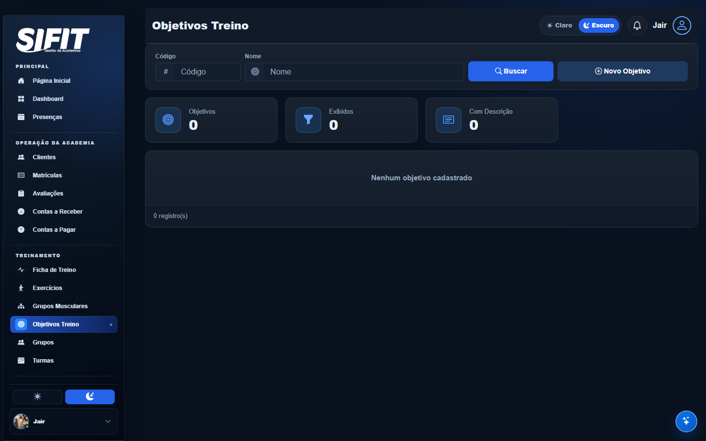

Persistência: `GET /api/objetivos-treino/1`.

### 6.4 Grupos

Objetivo: cadastrar grupos da academia (modalidade ou agrupamento comercial), com opção de aparecer na home e tipo de caixa.

Caminho: menu **Treinamento → Grupos** (`/grupos`).

Esse **Grupos** é o grupo da academia no SIFIT. Não é a tabela `grupos` do MySQL da aula, cujos nomes são categorias de informática (monitores, processadores, placas de vídeo).

Passo a passo:

1. Abrir **Grupos**.
2. A tabela mostra código, nome, descrição, mostrar home, tipo de caixa, status e ações.
3. Em **Novo Grupo**, informar nome, status, mostrar home, tipo de caixa e descrição.
4. **Salvar Grupo** grava. Não foi clicado.

Evidência:

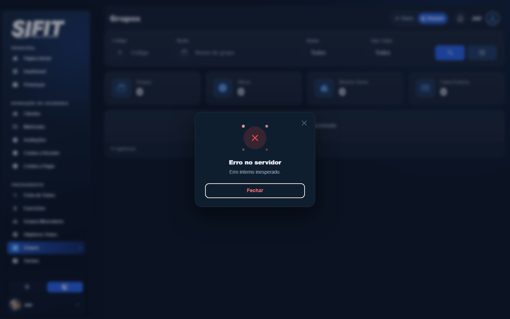

Persistência: `GET /api/grupos/1`. Gravação não executada: `POST /api/adiciona/grupo/` e `POST /api/edita/grupo/`.

### 6.5 Turmas

Objetivo: montar a grade de aulas (plano, horário e dias da semana).

Caminho: menu **Treinamento → Turmas** (`/turmas`).

Passo a passo:

1. Abrir **Turmas**.
2. Buscar por código, nome e status.
3. A tabela mostra código, nome da turma, plano, horário, dias e status.
4. Em **Cadastrar Turma**, informar nome, status, plano, aula experimental, tempo em meses, hora inicial, hora final, se tem personal e os dias da semana.

Evidência:

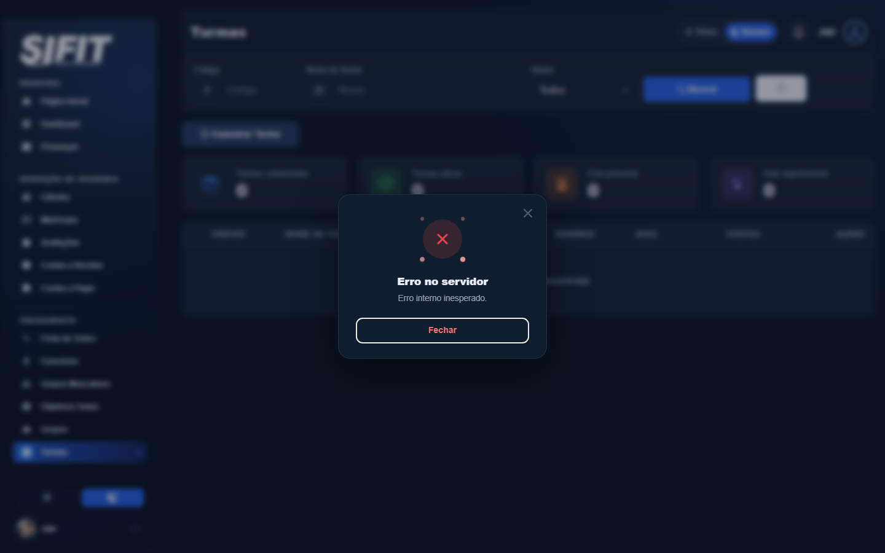

Persistência: `GET /api/turma/listar/1`, com apoio de `GET /api/planos/1` e `GET /api/colaboradores-personais/1`. Criar turma, não executado: `POST /api/turma/criar/`.

## 7. Financeiro

### 7.1 Caixas

Objetivo: abrir e fechar o caixa do dia e ver o movimento.

Caminho: menu **Financeiro → Caixas** (`/caixas`).

Passo a passo:

1. Abrir **Caixas**.
2. Filtrar data inicial, data final e status (todos, aberto ou fechado).
3. A tabela mostra código, data inicial, data final, status e ações.
4. **Abrir Caixa** pede funcionário e local de contas.
5. O fechamento e a conferência existem na API e não foram executados.

Evidência:

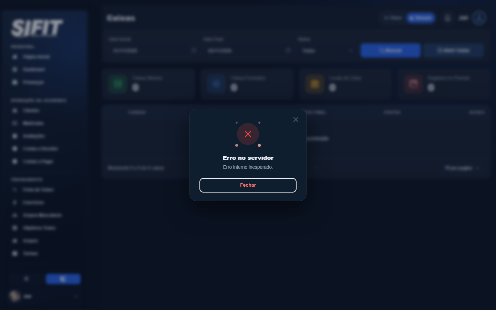

Persistência: a listagem usa as rotas de caixa da API (`/api/caixa/caixas-paginacao/` e `/api/seleciona/caixa/`). Abrir caixa usa `POST /api/abrir-caixa/`. Nenhuma abertura ou fechamento foi feito neste trabalho.

### 7.2 Pagar.me

Objetivo: ver saldo, transações, recebíveis e gerar cobrança pelo gateway.

Caminho: menu **Financeiro → Pagar.me** (`/pagarme`).

Passo a passo:

1. Abrir **Pagar.me**.
2. Ver saldo disponível e valor em processamento.
3. Consultar recebimentos, meios de pagamento, transações recentes e repasses.
4. As ações de saque, nova cobrança e configuração existem na tela. Nenhuma movimentação financeira foi disparada.

Evidência:

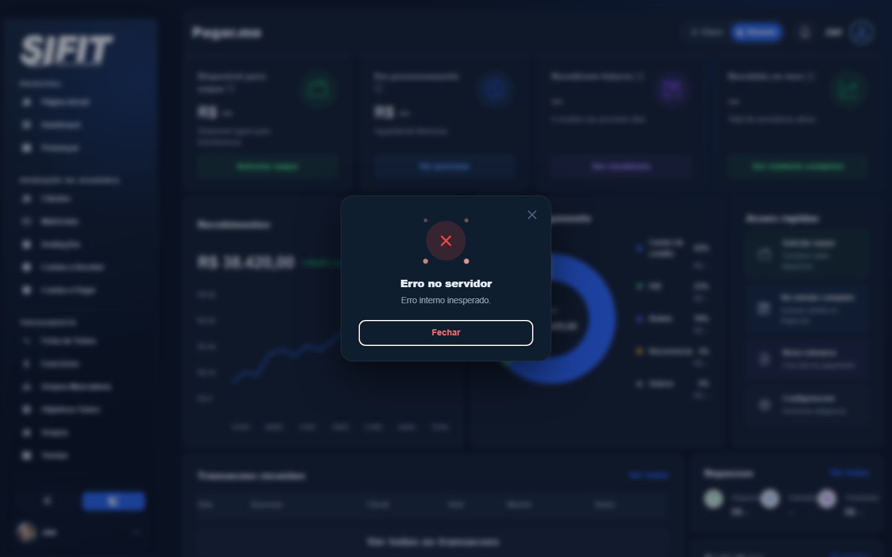

Persistência: a tela fala com os endpoints `/api/pagarme/transacoes`, `/api/pagarme/recebiveis`, `/api/pagarme/relatorio-mes` e `/api/ver-saldo`. Criar cobrança (`/api/pagarme/criar-cobranca`) e sacar (`/api/sacar-saldo`) não foram usados.

### 7.3 Despesas fixas

Objetivo: cadastrar contas que se repetem (aluguel, internet, energia).

Caminho: menu **Financeiro → Despesas Fixas** (`/despesas-fixas`).

Passo a passo:

1. Abrir a lista: código, nome, valor, recorrência, status e ações.
2. Em **Nova Despesa**, informar nome, status, valor e recorrência.
3. **Salvar Despesa** grava. Não foi clicado.

Evidência:

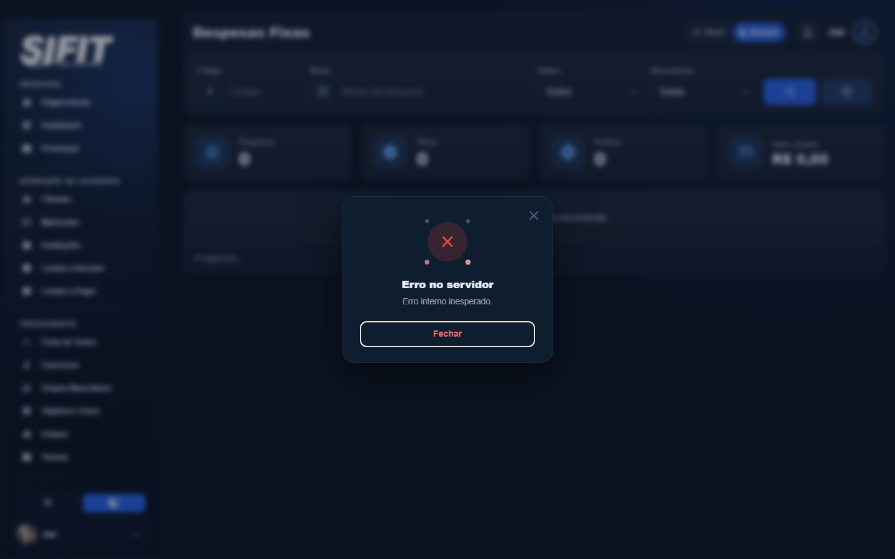

Persistência: `GET /api/despesas-fixas/1`. Gravação não executada: `POST /api/cria/despesa-fixa/`.

### 7.4 Relatórios

Objetivo: exportar listagens por período.

Caminho: menu **Financeiro → Relatórios** (`/relatorios`).

Passo a passo:

1. Abrir **Relatórios**.
2. Escolher o tipo: avaliações, clientes, colaboradores, matrículas, contas a receber, contas a pagar ou caixas.
3. Informar data início e data fim.
4. Clicar em **Gerar Relatório**.

Evidência:

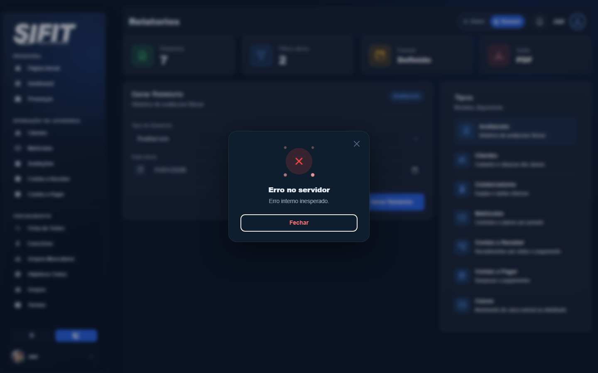

Persistência: a geração usa `POST /api/relatorio/` (e `/api/relatorio/caixa-detalhado/` quando o caixa é detalhado). O arquivo sai da API; não há tabela de relatório no MySQL do slide.

### 7.5 Cadastros de apoio do financeiro

Estes três cadastros sustentam contas e caixa.

**Bancos** (`/bancos`): código, nome e código do banco. Lista em `GET /api/bancos/1`.

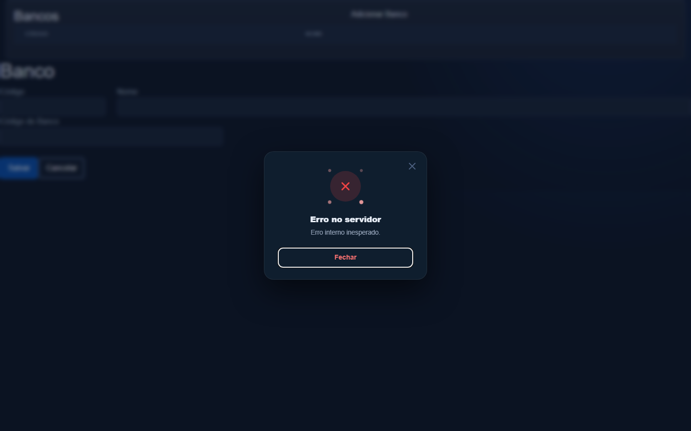

**Local de contas** (`/local-contas`): código, nome e status. Lista em `GET /api/local-contas/1`. É o local pedido ao abrir o caixa.

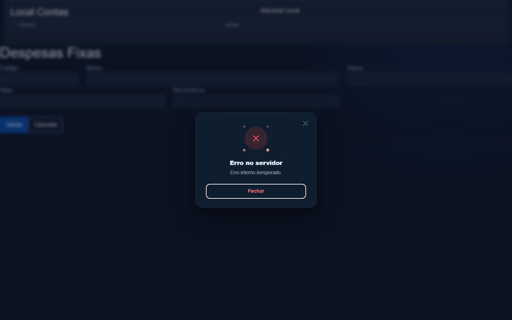

**Categorias de conta a pagar** (`/categorias-conta-pagar`): código e nome. Lista em `POST /api/categoria-contas-pagar/1`.

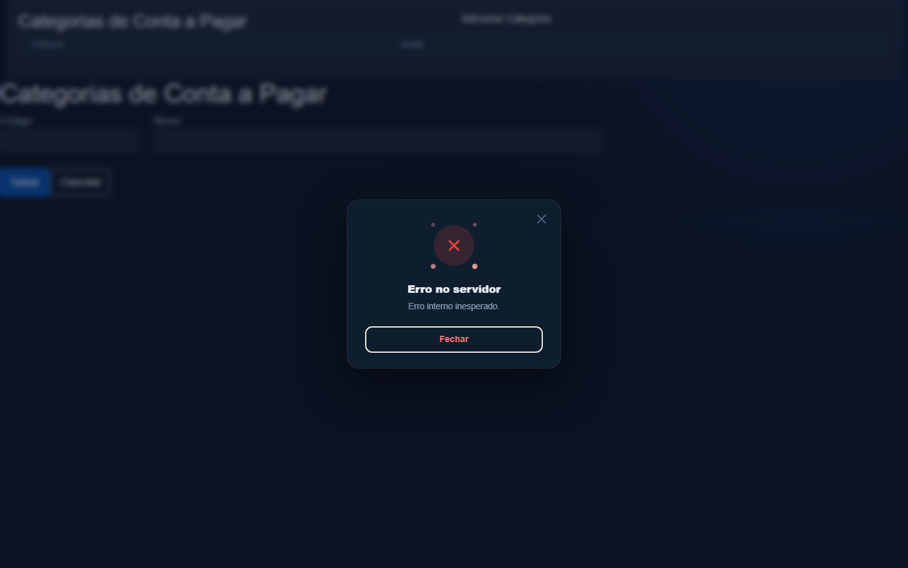

## 8. Comercial

### 8.1 Prospecção

Objetivo: acompanhar leads antes de virarem aluno.

Caminho: menu **Comercial → Prospecção** (`/prospeccao`).

Passo a passo:

1. Abrir **Prospecção**.
2. Buscar por nome e filtrar o estágio.
3. A tabela mostra código, nome, estágio e data de criação.
4. **Adicionar Lead** pede nome, estágio, e-mail e telefone.
5. **Salvar Lead** grava. Não foi clicado.

Evidência:

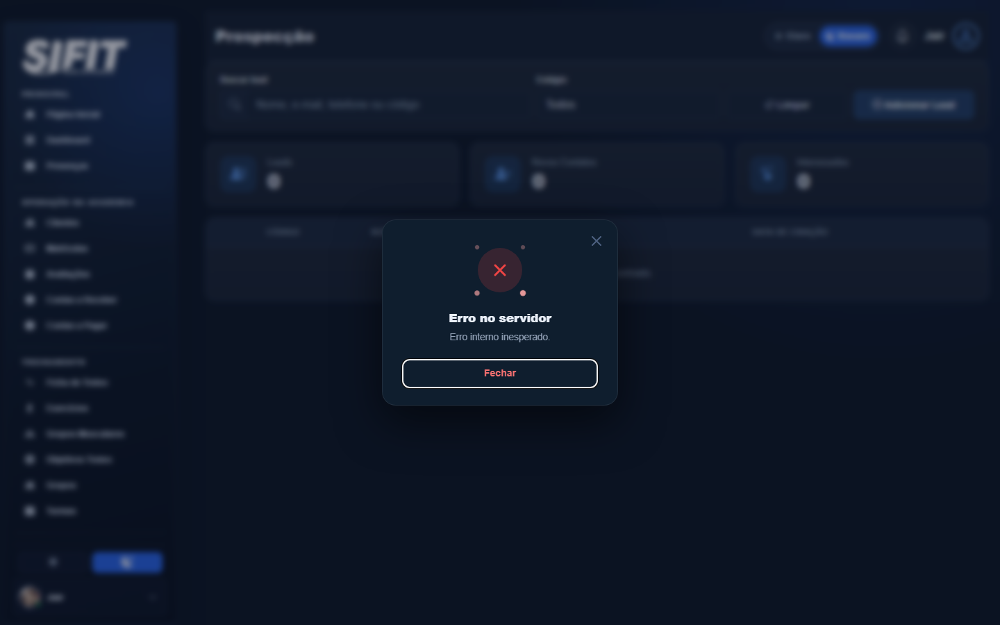

Persistência: a lista e o quadro de estágios são carregados pela API da própria tela de prospecção. O lead só entra na base se **Salvar Lead** for confirmado.

### 8.2 Planos

Objetivo: definir o que a academia vende (nome, valor, duração, parcelas e personal).

Caminho: menu **Comercial → Planos** (`/planos`).

Passo a passo:

1. Abrir **Planos**.
2. Buscar por código, nome e status.
3. A tabela mostra código, nome, quantidade de alunos, valor, duração e status. A tela também destaca os planos com mais alunos.
4. Em **Novo Plano**, informar nome, grupo, status, tipo de cobrança, parcelas, valor mensal, valor da matrícula e se tem personal.
5. A opção **Salvar também na Pagar.me** replica o plano no gateway. Não foi usada.

Evidência:

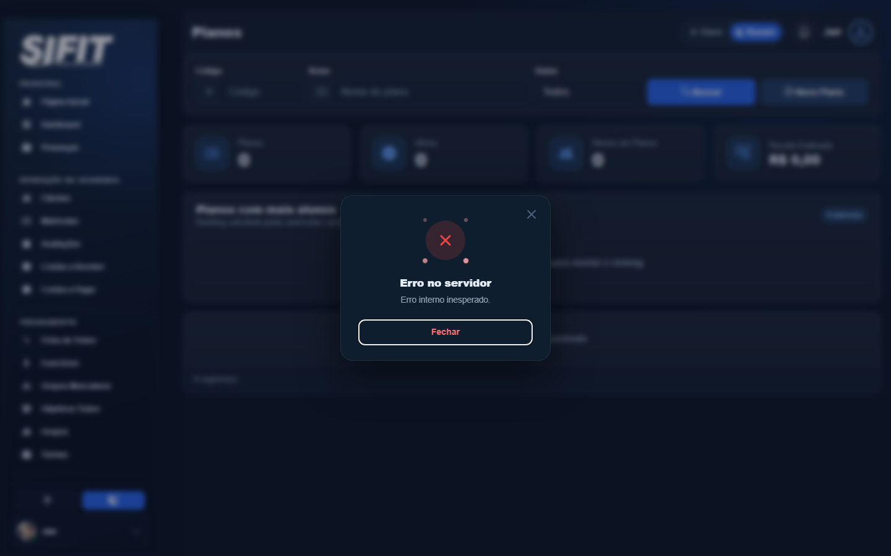

Persistência: `GET /api/planos/1`. Gravação não executada: `POST /api/plano/salvar/`. A cópia no gateway, também não executada, usa `/api/planos/pagarme`.

### 8.3 Modelos de contrato

Objetivo: guardar o texto do contrato usado na matrícula.

Caminho: menu **Comercial → Modelos Contrato** (`/modelos-contrato`).

Passo a passo:

1. Abrir a lista (código, nome e status).
2. Clicar em **Adicionar Modelo Contrato**.
3. O editor do modelo fica em `/adicionar-modelo-contrato`.

Evidência:

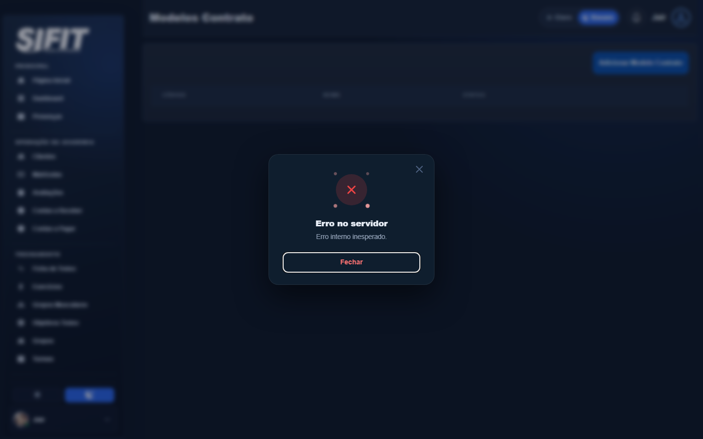

Persistência: `GET /api/modelos-contrato/1`. Gravação não executada: `POST /api/modelo-contrato/salvar/`.

### 8.4 Tipos de pagamento

Objetivo: cadastrar dinheiro, cartão, PIX e se o pagamento passa pelo sistema.

Caminho: menu **Comercial → Tipos de Pagamento** (`/tipos-pagamento`).

Passo a passo:

1. Abrir a lista: código, nome, tipo, via gateway e status.
2. Clicar em **Novo**.
3. Informar nome, status, se escolhe bandeira, o tipo e se o pagamento é pelo sistema.
4. **Salvar** grava. Não foi clicado.

Evidência:

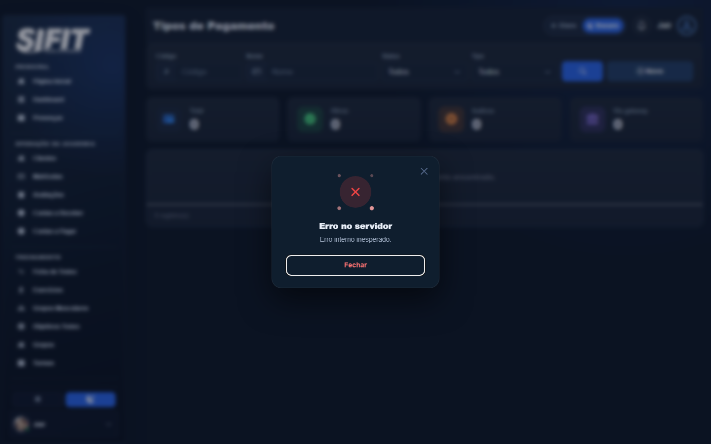

Persistência: `GET /api/tipo-pagamento/1`, a mesma lista usada em matrícula e contas.

### 8.5 Bandeiras

Objetivo: cadastrar bandeiras de cartão e a taxa por parcela.

Caminho: menu **Comercial → Bandeiras** (`/bandeiras`).

Passo a passo:

1. Abrir **Bandeiras de Cartão**.
2. **Nova Bandeira** pede nome, taxa adicional, taxa de débito e se a taxa adicional multiplica por mês.
3. **Adicionar Parcela** informa número da parcela e taxa.
4. Nada foi salvo.

Evidência:

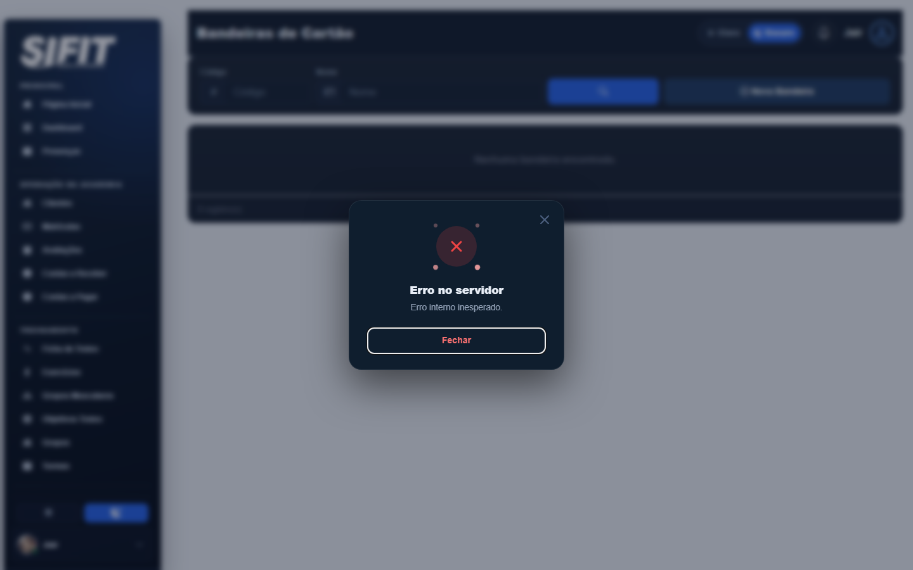

Persistência: listagem e parcelas pelas rotas `/api/bandeiras/` e `/api/parcela-por-bandeiras/`. Criar bandeira, não executado: `POST /api/cria/bandeira/`.

## 9. Gestão

### 9.1 Colaboradores

Objetivo: cadastrar a equipe (recepção, professor, personal, avaliador).

Caminho: menu **Gestão → Colaboradores** (`/colaboradores`).

Passo a passo:

1. Buscar por código e nome.
2. A tabela mostra código, nome, status e biometria / dias desde a última visita.
3. **Novo Colaborador** (`/adicionar-colaborador`) separa os dados em blocos: dados principais, documentos, login (admin, normal ou sem login), contato, endereço, biometria e observação.
4. **Gerenciar Funções** abre o vínculo da pessoa com uma função.
5. **Salvar** não foi clicado.

Evidências:

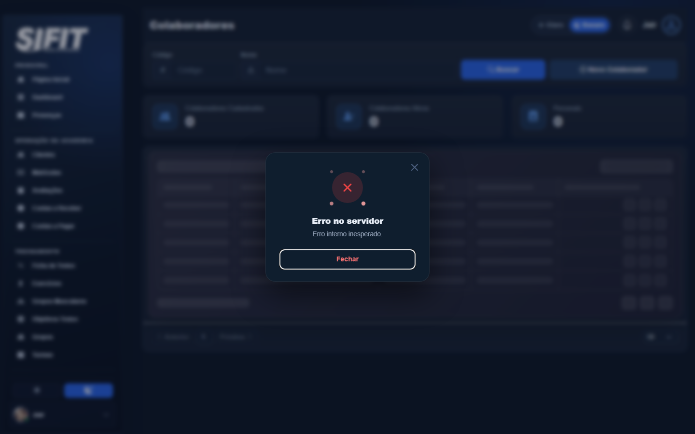

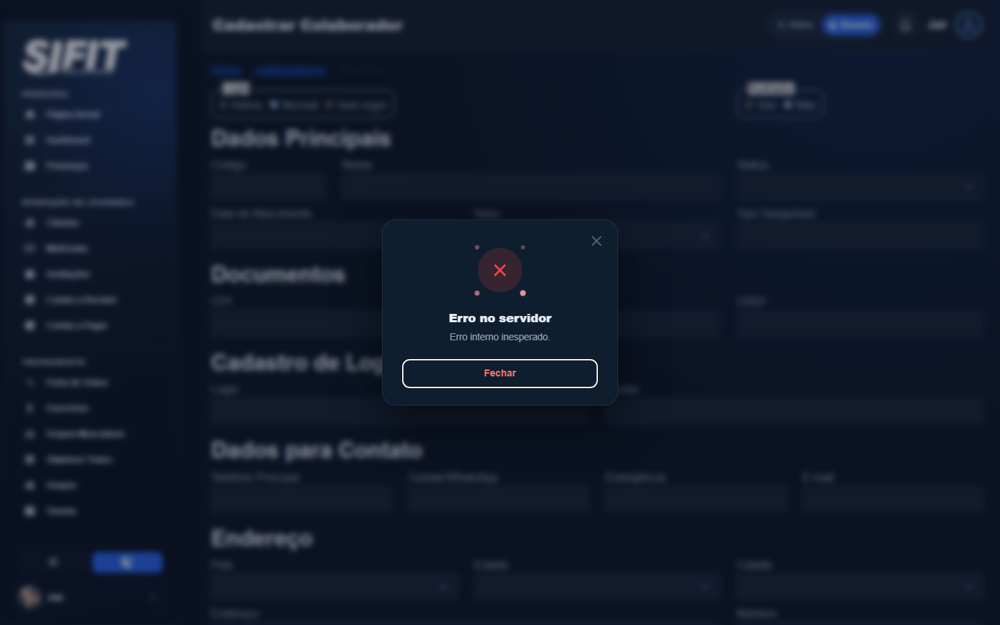

Persistência: a grade usa as rotas `/api/colaboradores/`. O salvamento, não executado, é `POST /api/salvar/colaborador/`.

### 9.2 Funções

Objetivo: definir o papel e as permissões de tela.

Caminho: menu **Gestão → Funções** (`/funcoes`).

Passo a passo:

1. Buscar a função.
2. A tabela mostra código, nome, tipo, se é personal, se é avaliador e ações.
3. **Nova Função** pede nome, tipo de funcionário, personal e avaliador.
4. O bloco **Permissões** marca o que aquele papel pode ver e fazer.
5. Nada foi salvo.

Evidência:

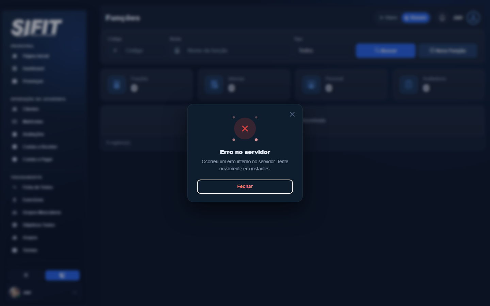

Persistência: `GET /api/funcoes-colaborador/`. Permissões: `GET /api/permissoes-por-funcao/` e `POST /api/cria/permissoes-funcao/` (não executado).

### 9.3 Fornecedores

Objetivo: cadastrar quem emite as contas a pagar.

Caminho: menu **Gestão → Fornecedores** (`/fornecedores`).

Passo a passo:

1. Buscar por código e nome.
2. A tabela mostra código, nome e status.
3. **Novo Fornecedor** pede pessoa física ou jurídica, nome, status, CNPJ, telefones, e-mail e endereço.
4. **Salvar** não foi clicado.

Evidências:

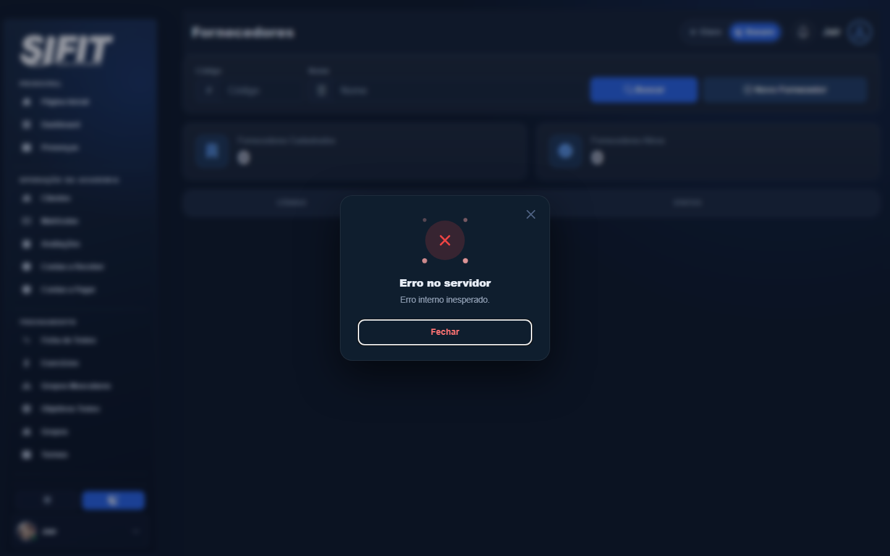

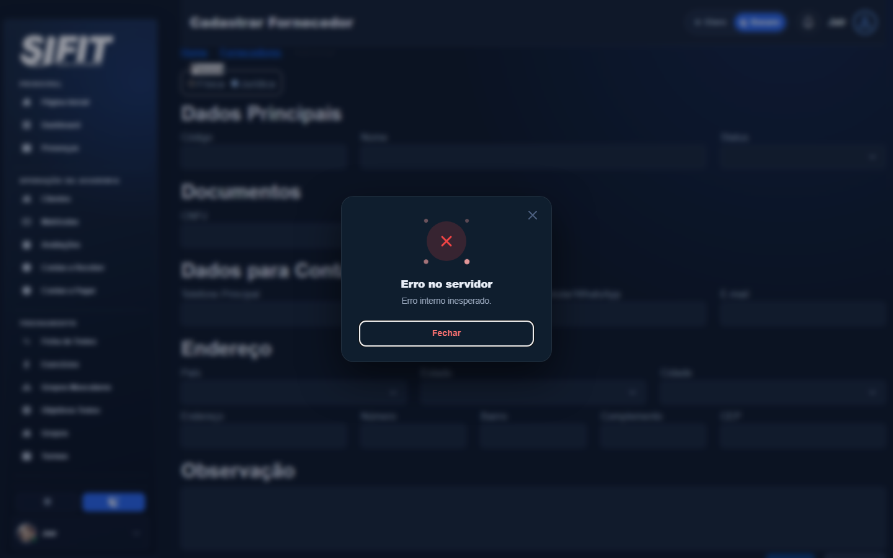

Persistência: `GET /api/fornecedores/1`. Gravação não executada: `POST /api/salvar-fornecedor/`.

### 9.4 Tipos de documentos

Objetivo: classificar o documento da conta a pagar (nota, recibo, boleto).

Caminho: menu **Gestão → Tipos de Documentos** (`/tipos-documento`).

Passo a passo:

1. Ver a lista: código, nome e aplicação.
2. **Novo Tipo** pede nome e aplicação.
3. **Salvar** não foi clicado.

Evidência:

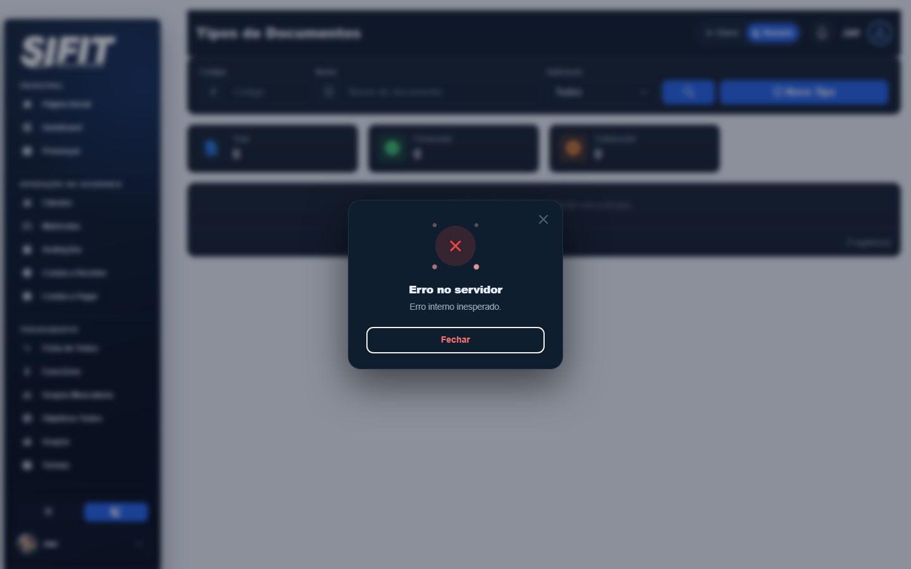

Persistência: `GET /api/tipos-documento/1`, consumido também pelo formulário de conta a pagar.

### 9.5 Atividades

Objetivo: cadastrar atividades que geram pontos.

Caminho: menu **Gestão → Atividades** (`/atividades`).

Passo a passo:

1. Buscar por código e nome.
2. A tabela mostra código, nome, descrição e pontuação.
3. **Nova Atividade** pede nome, pontuação e descrição.

Evidência:

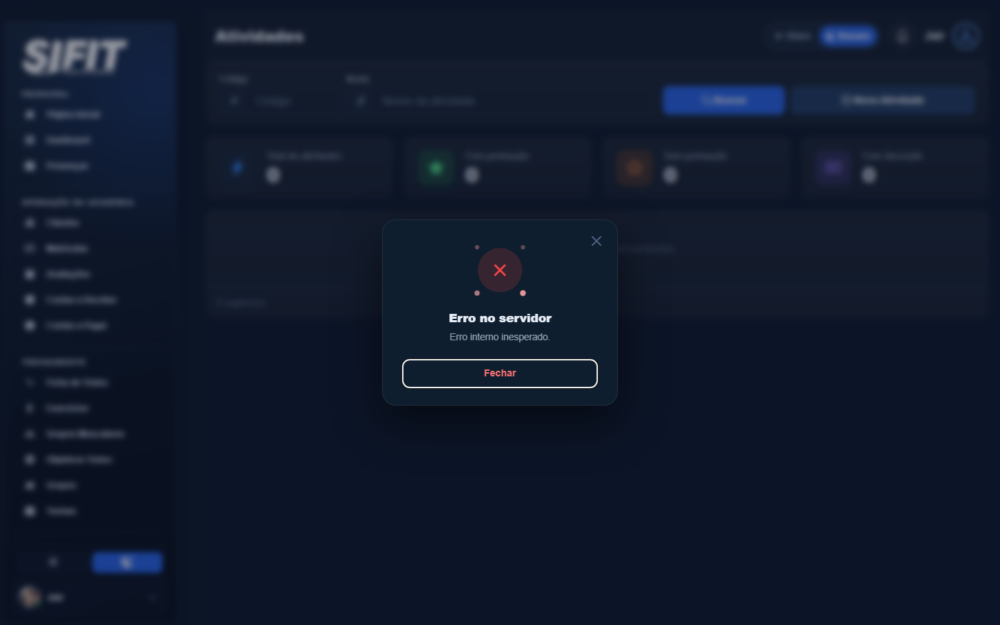

Persistência: `POST /api/buscar-atividades/` na listagem. Gravação não executada: `POST /api/salvar-atividade/`.

### 9.6 Pontuação

Objetivo: campanhas em que o aluno junta pontos e troca por produto.

Caminho: menu **Gestão → Pontuação** (`/pontuacao`).

Passo a passo:

1. Abrir **Pontuação**.
2. A lista mostra código, nome, tipo, período, status e ações.
3. A mesma tela reúne produtos de resgate, atividades da campanha, ranking e pedidos de tarefa.
4. **Nova Pontuação** pede nome, datas, tipo, status, produto e atividade.
5. Nada foi criado nem avaliado.

Evidência:

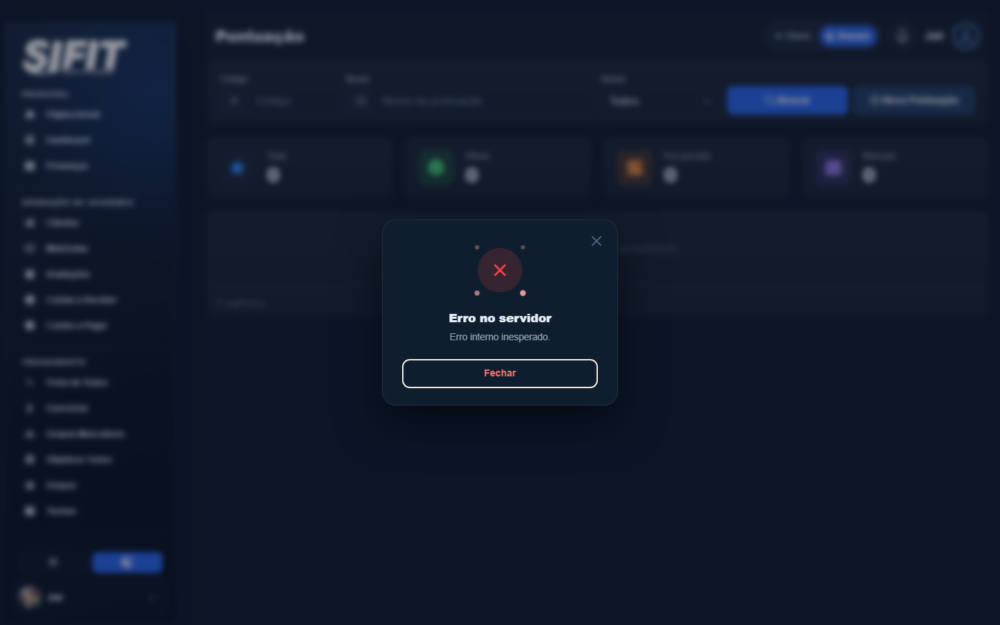

Persistência: `POST /api/buscar-pontuacoes/` e `POST /api/buscar-pessoas-por-pontuacao/`. Gravação não executada: `POST /api/salvar-pontuacao/`.

### 9.7 Produtos

Objetivo: cadastrar o que pode ser vendido ou resgatado com pontos.

Caminho: menu **Gestão → Produtos** (`/produtos`).

Passo a passo:

1. A tabela mostra código, nome, tipo, valor ou pontos e status.
2. **Novo** pede nome, status, descrição, tipo, preço e imagens.
3. **Salvar** não foi clicado.

Evidência:

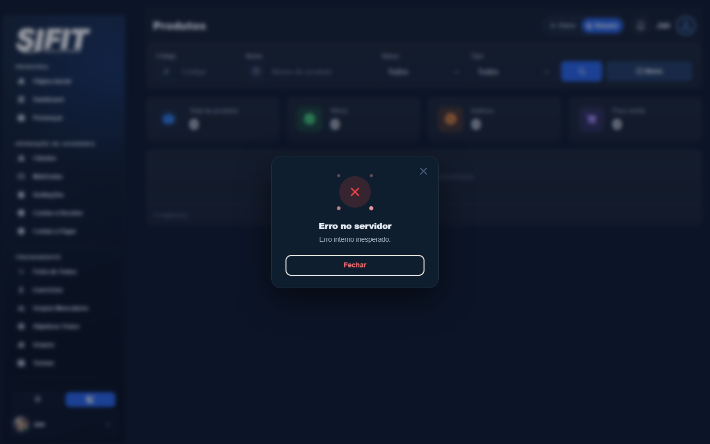

Persistência: `GET /api/produtos/1`. Esta lista é do SIFIT. A tabela `produtos` do MySQL da aula tem 1 produto de loja e não é a origem desta tela.

### 9.8 Enquetes

Objetivo: publicar uma pergunta com alternativas para os alunos.

Caminho: menu **Gestão → Enquetes** (`/enquetes`).

Passo a passo:

1. Buscar a enquete.
2. A tabela mostra código, nome, pergunta e status.
3. **Nova Enquete** pede nome, status, pergunta e as respostas (Resposta 1 em diante).
4. A tela também lista as respostas recebidas.

Evidência:

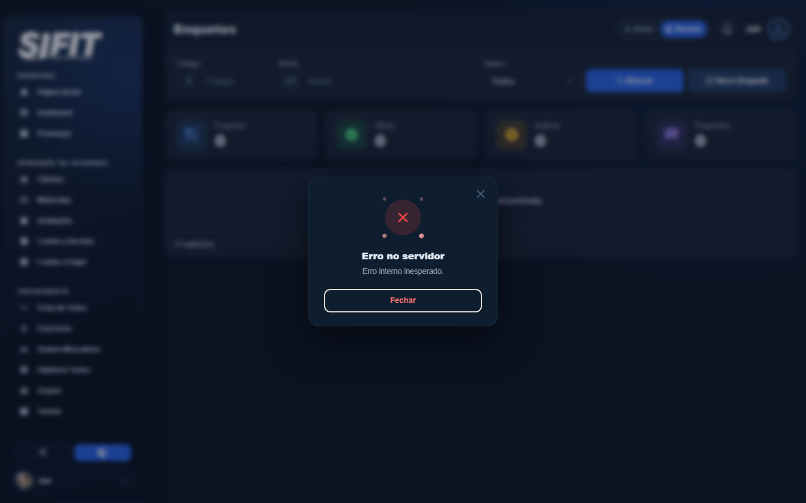

Persistência: `GET /api/enquetes/`. Gravação não executada: `POST /api/enquete/salvar/`.

## 10. Saúde

### 10.1 Fichas de anamnese

Objetivo: aplicar o questionário de saúde no aluno.

Caminho: menu **Saúde → Fichas Anamnese** (`/anamneses`).

Passo a passo:

1. Abrir **Fichas de Anamnese**.
2. **Nova Anamnese** inicia a aplicação de um modelo em um aluno.
3. A configuração da matrícula pode perguntar se a anamnese deve ser feita ao concluir o contrato.

Evidência:

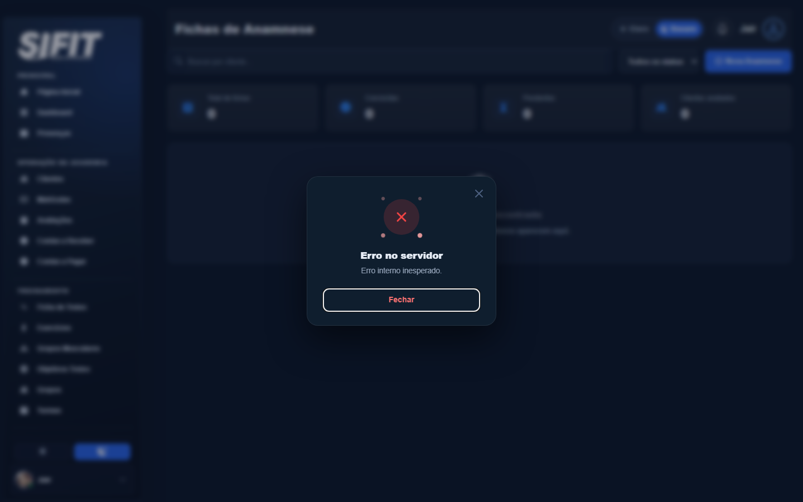

Persistência: a aplicação usa `/api/anamnese/aplicar/` e o salvamento usa `POST /api/ficha-anamnese/salvar/`. Nenhum questionário foi respondido neste trabalho.

### 10.2 Modelos de anamnese

Objetivo: montar o questionário padrão.

Caminho: menu **Saúde → Modelos** (`/anamnese/modelos`).

Passo a passo:

1. Abrir **Modelos de Anamnese**.
2. Usar **Preview** para ver o questionário como o aluno verá.
3. Um modelo agrupa categorias e perguntas.

Evidência:

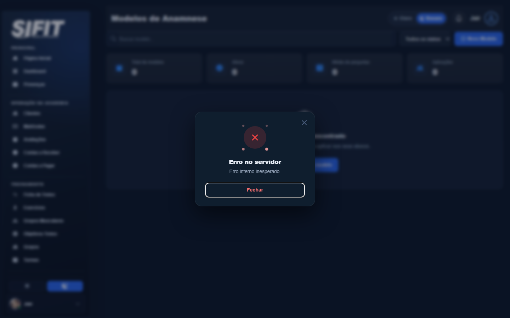

Persistência: `GET /api/modelos-anamnese/`. Gravação não executada: `POST /api/modelos-anamnese/salvar/`.

### 10.3 Categorias de anamnese

Objetivo: agrupar as perguntas (histórico, lesões, hábitos).

Caminho: menu **Saúde → Categorias** (`/anamnese/categorias`).

Passo a passo:

1. Abrir **Categorias de Anamnese**.
2. **Nova Categoria** cria o grupo de perguntas.

Evidência:

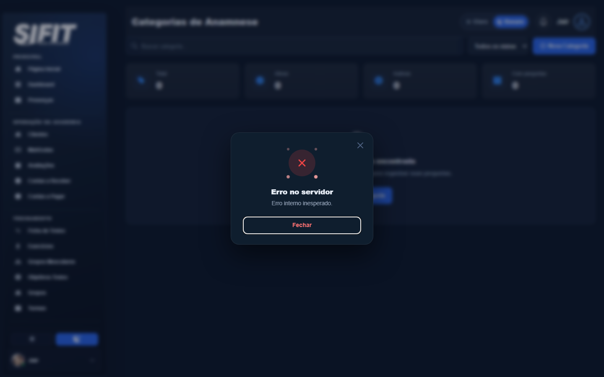

Persistência: `GET /api/categorias-anamnese/`. Gravação não executada: `POST /api/categorias-anamnese/salvar/`.

### 10.4 Perguntas de anamnese

Objetivo: escrever cada pergunta e o tipo de resposta.

Caminho: menu **Saúde → Perguntas** (`/perguntas-anamnese`).

Passo a passo:

1. Buscar por código e nome.
2. A tabela mostra código, nome, pergunta, tipo de resposta e status.
3. **Nova Pergunta** pede nome, status, texto, número e tipo de resposta.

Evidência:

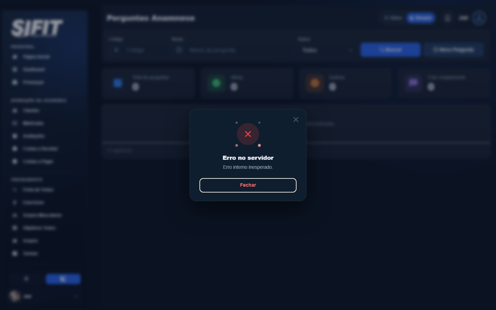

Persistência: `GET /api/perguntas-anamnese/`. Gravação não executada: `POST /api/pergunta-anamnese/salvar/`.

## 11. Inteligência

### 11.1 Inteligência e automação

Objetivo: ver e disparar regras que procuram alunos em risco, inadimplentes e inativos.

Caminho: menu **Inteligência → Inteligência & Automação** (`/inteligencia-automacao`).

Passo a passo:

1. Abrir a **Central de Automações**.
2. Ver quais automações estão ativas e quais estão disponíveis.
3. Ler a atividade recente.
4. **Executar agora** roda a regra na hora. **Configurar** ajusta a regra. **Ver resultados** abre a tela seguinte.
5. Nenhuma automação foi executada nem reconfigurada.

Evidência:

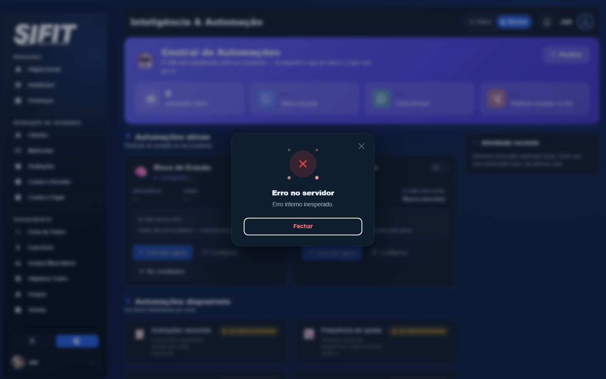

Persistência: os resultados lidos na página inicial e aqui vêm de `GET /api/dashboard/retencao/1` e `GET /api/inteligencia/resultados/1`.

### 11.2 Resultados da inteligência

Objetivo: consultar o que as automações já encontraram.

Caminho: menu **Inteligência → Resultados IA** (`/inteligencia/resultados`).

Passo a passo:

1. Filtrar o período: hoje, 7, 30 ou 90 dias.
2. Ler o que o SIFIT identificou.
3. A tabela de automações mostra nome, execuções, resultados encontrados e última execução. No levantamento a última análise da retenção estava em 17/11/2026, 00:55.

Evidência:

Persistência: `GET /api/inteligencia/resultados/1`.

## 12. Configurações

### 12.1 Configurações da academia

Objetivo: ligar ou desligar regras que mudam o comportamento das outras telas.

Caminho: menu **Configurações → Configurações** (`/configuracoes`).

Abas observadas: Home, Biometria, Avaliação, Aniversário, Pagamento, Integrações e Design.

Campos que alteram o resto do sistema:

| Campo | Efeito |
| --- | --- |
| Plano do SIFIT | plano contratado da própria plataforma |
| Liberar acesso ao sistema desktop | habilita o desktop |
| Controle de presença | define como a presença entra (ligada à tela Presenças) |
| Academia marcada como Box | muda a operação para aula em grupo |
| Trabalha com turmas | exibe o uso de turmas na matrícula e na agenda |
| Dias para contar cliente como ausente | alimenta o indicador de ausentes da página inicial |
| Cobrar multa por atraso | entra no recebimento |
| Imprimir comprovante de recebimento | vale para o desktop |
| Perguntar sobre anamnese ao concluir matrícula | abre a anamnese no fim do contrato |

Evidência:

Persistência: `GET /api/configuracoes/1` e `POST /api/planos-sifit/1`. A gravação é `POST /api/configuracoes/alterar/`. Nenhuma opção foi alterada.

### 12.2 Modelo de ficha

Objetivo: criar um treino modelo para reutilizar em vários alunos.

Caminho: menu **Configurações → Modelo Ficha** (`/fichas-treino-modelo`).

Passo a passo:

1. Abrir **Modelos de Ficha**.
2. Buscar por código, título e criador.
3. **Criar Modelo** pede nome do modelo e personal.
4. A montagem dos exercícios segue a mesma biblioteca da ficha do aluno.

Evidência:

Persistência: `GET /api/fichas-modelo/1`.

### 12.3 Aplicativo

Objetivo: moderar o app do aluno (notificações, postagens e denúncias).

Caminho: menu **Configurações → Aplicativo** (`/aplicativo`).

Passo a passo:

1. Abrir **Aplicativo**.
2. Em **Notificações**, ver código, mensagem e data, ou **Criar Notificação** (mensagem, destinatário e prévia no celular).
3. Em **Postagens**, ver código, texto, status e data.
4. Em **Denúncias**, ver a postagem denunciada e o motivo. **Recusar** ou aprovar muda o status. Nenhuma denúncia foi moderada.

Evidência:

Persistência:

| Método | Caminho |
| --- | --- |
| GET | `/api/notificacoes/listar/1` |
| GET | `/api/posts/listar/1` |
| GET | `/api/denuncias/listar/1` |

## 13. Mapa rápido: tela, print e leitura

| Função | Rota | Print | Leitura que a tela fez |
| --- | --- | --- | --- |
| Login | `/login` | `01-login.png` | sessão em `verifica-token-logado` |
| Página inicial | `/dashboard` | `02-pagina-inicial.png` | `dados-principais-home`, `dashboard/retencao` |
| Dashboard | `/dash` | `03-dashboard.png` | presença, idade, sexo, matrículas, avaliações |
| Presenças | `/presencas` | `04-presencas.png` | `presencas/paginacao` |
| Clientes | `/clientes` | `05-clientes.png` | `clientes-paginacao`, `clientes/tela-web` |
| Matrículas | `/matriculas` | `06-matriculas.png` | `matriculas/paginacao` |
| Avaliações | `/avaliacoes` | `07-avaliacoes.png` | `avaliacao/tela-web` |
| Contas a receber | `/contas-receber` | `08-contas-receber.png` | `contas-receber/tela-web` |
| Contas a pagar | `/contas-pagar` | `09-contas-pagar.png` | `contas-pagar/por-data` |
| Ficha de treino | `/fichas-treino` | `10-ficha-treino.png` | `fichas` |
| Exercícios | `/exercicios` | `11-exercicios.png` | `grupo-muscular` |
| Grupos musculares | `/grupos-musculares` | `12-grupos-musculares.png` | `grupo-muscular` |
| Objetivos | `/objetivos-treino` | `13-objetivos-treino.png` | `objetivos-treino` |
| Grupos | `/grupos` | `14-grupos.png` | `grupos` |
| Turmas | `/turmas` | `15-turmas.png` | `turma/listar` |
| Caixas | `/caixas` | `16-caixas.png` | caixa / paginação |
| Pagar.me | `/pagarme` | `17-pagarme.png` | transações, saldo, recebíveis |
| Despesas fixas | `/despesas-fixas` | `18-despesas-fixas.png` | `despesas-fixas` |
| Relatórios | `/relatorios` | `19-relatorios.png` | `relatorio` |
| Prospecção | `/prospeccao` | `20-prospeccao.png` | leads da prospecção |
| Planos | `/planos` | `21-planos.png` | `planos` |
| Modelos de contrato | `/modelos-contrato` | `22-modelos-contrato.png` | `modelos-contrato` |
| Tipos de pagamento | `/tipos-pagamento` | `23-tipos-pagamento.png` | `tipo-pagamento` |
| Bandeiras | `/bandeiras` | `24-bandeiras.png` | `bandeiras` |
| Colaboradores | `/colaboradores` | `25-colaboradores.png` | `colaboradores` |
| Funções | `/funcoes` | `26-funcoes.png` | `funcoes-colaborador` |
| Fornecedores | `/fornecedores` | `27-fornecedores.png` | `fornecedores` |
| Tipos de documento | `/tipos-documento` | `28-tipos-documento.png` | `tipos-documento` |
| Atividades | `/atividades` | `29-atividades.png` | `buscar-atividades` |
| Pontuação | `/pontuacao` | `30-pontuacao.png` | `buscar-pontuacoes` |
| Produtos | `/produtos` | `31-produtos.png` | `produtos` |
| Enquetes | `/enquetes` | `32-enquetes.png` | `enquetes` |
| Anamneses | `/anamneses` | `33-anamneses.png` | fichas de anamnese |
| Modelos de anamnese | `/anamnese/modelos` | `34-anamnese-modelos.png` | `modelos-anamnese` |
| Categorias de anamnese | `/anamnese/categorias` | `35-anamnese-categorias.png` | `categorias-anamnese` |
| Perguntas | `/perguntas-anamnese` | `36-anamnese-perguntas.png` | `perguntas-anamnese` |
| Inteligência | `/inteligencia-automacao` | `37-inteligencia.png` | automações e retenção |
| Resultados | `/inteligencia/resultados` | `38-resultados-ia.png` | `inteligencia/resultados` |
| Configurações | `/configuracoes` | `39-configuracoes.png` | `configuracoes` |
| Modelo de ficha | `/fichas-treino-modelo` | `40-modelo-ficha.png` | `fichas-modelo` |
| Aplicativo | `/aplicativo` | `41-aplicativo.png` | posts, notificações, denúncias |

Os prints `42` a `52` são os formulários e os cadastros de apoio citados nas seções 5, 7 e 9.

## 14. Vídeos

As gravações abrem nesta página, cada uma com o próprio player: [assistir os vídeos](https://ale7639.github.io/extensao-6-SIFIT-Diego-Wallace/manual-sifit/evidencias/video/assistir.html).

1. Início e presença — `evidencias/video/01-inicio-e-presenca.mp4`
2. Clientes e matrículas — `evidencias/video/02-clientes-e-matriculas.mp4`
3. Avaliações e treino — `evidencias/video/03-avaliacoes-e-treino.mp4`
4. Financeiro — `evidencias/video/04-financeiro.mp4`
5. Cadastros — `evidencias/video/05-cadastros.mp4`
6. Anamnese e aplicativo — `evidencias/video/06-anamnese-e-aplicativo.mp4`
7. Percurso completo, da página inicial até o aplicativo — `evidencias/video/manual-sifit-telas.mp4`

O material da aula pede esses vídeos também no Google Drive. O link deve ser colado no [README](../README.md), no lugar de `COLOCAR_LINK_DO_GOOGLE_DRIVE`.

Sugestão de narração, se a dupla for regravar com o Jam:

1. Mostrar o login e a página inicial, lendo dois números (ativos e valor em aberto).
2. Abrir Clientes, apontar um código da lista e dizer que a tela chamou `POST /api/clientes-paginacao/1`.
3. Abrir o MySQL Workbench no schema `u339572246_alfa1`, mostrar `SHOW TABLES` e que não existe tabela de matrícula nem de presença.
4. Voltar e percorrer matrícula, avaliação, ficha, caixa e configurações.

## 15. O que ficou de fora de propósito

- Senhas do slide.
- Gravação, edição, cancelamento, cobrança, saque e moderação. O ambiente é compartilhado pela turma.
- Dados pessoais além do que o print da própria tela já mostra. CPF, e-mail e telefone não são transcritos aqui.
